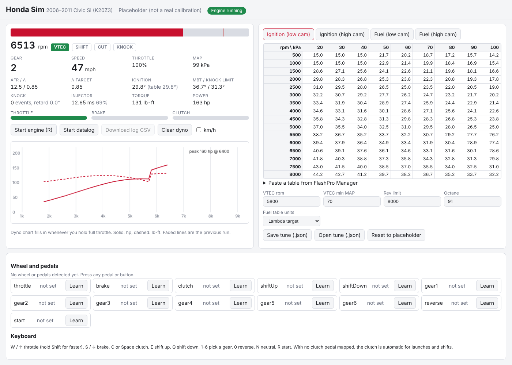

# Honda Sim

A drive-it-yourself simulator for testing Honda tunes, starting with the 2006–2011 Civic Si (K20Z3, 6-speed).
Load your tune's tables, drive with a wheel and pedals (or the keyboard), and watch what the engine does:
VTEC switch, knock, mixture, power, and a live dyno chart.



## Run it

```
npm start
```

Then open http://localhost:8080 in Chrome or Edge. No install step: there are no dependencies.

## Getting your tune in

FlashPro `.fpcal` files are encrypted, so the sim can't read them directly. Copy the tables out of FlashPro Manager instead:

1. Open the calibration in FlashPro Manager (no car or FlashPro device needed).
2. Click inside a table, press **Ctrl+A** then **Ctrl+C**.
3. In Honda Sim, open **Paste a table from FlashPro Manager**, paste, pick which table it is, and press **Load into tune**.
4. Do this for the low and high cam ignition and fuel tables, then set the VTEC point and rev limit.
5. **Save tune (.json)** keeps the result so you don't have to paste again.

Have the tables as CSV files instead? **Load CSV tables** takes several at once and picks the table from the file name
(`afr`, `fuel`, `ignition`, `boost`, `wg_duty`, `cam` or `vtc`). A single ignition, fuel or cam angle table is used for both cams.

The fuel table can be lambda, AFR or injector pulse width (ms). The sim guesses from the numbers; check the **Fuel table units** setting.

## Wheel and pedals

Wheelbases and pedals show up in the browser as game controllers. Press any pedal so the browser notices them, then
use **Learn** next to each control: press the pedal all the way and let go, or press the paddle or button.
Mappings are saved in the browser. Without a clutch pedal mapped, the clutch works automatically for launches and shifts.

Keyboard: W/↑ throttle, S/↓ brake, C or Space clutch, E/Q shift up/down, 1–6 gears, 0 reverse, N neutral, R start.

## Turbo builds

**Turbo build preset** switches on a GT35-class turbo (turbine and wastegate sizes are estimates you can adjust), 1000 cc injectors, a 200 kPa overboost cut, an upgraded clutch,
and a torque warning (RODS lamp) at 350 Nm for stock connecting rods. Your tables stay as they are.
The turbine is driven by exhaust energy from the flow model, the compressor takes power to make boost, and the shaft
spools up from the difference. The wastegate opens past its spring plus whatever the wastegate duty table adds, and the
turbine's back pressure costs pumping work. How much boost a given duty makes depends on your solenoid and wastegate,
so set **WG duty gain** until the sim's boost matches a real datalog.

## Air and exhaust flow, timing and cams

Each cylinder is simulated through the whole cycle, degree by degree: cam lift on both cams, VTC cam phasing (from
your cam angle tables if you load them), compressible flow through the valves, the inertia of the air in the intake
runner and exhaust primary, exhaust back pressure, and a combustion burn that starts at the spark. Torque, peak
cylinder pressure, exhaust temperature and knock all come out of that, so timing, cams and exhaust changes act the way
they do on the engine. The dash shows cam angle, VE, where half the charge has burned, the knock margin, EGT,
exhaust pressure, pumping loss and residual exhaust. Throttle body, intake runner and exhaust size are in the
settings. Details and what's estimated: [docs/GASFLOW.md](docs/GASFLOW.md).

## Engine internals

The **Engine internals** panel shows peak cylinder pressure, piston temperature and rod forces, and the load on
each part (pistons, rods, rod bolts, bearings, crank, head gasket, head bolts, cylinder sleeves, block, valvetrain)
against its material limits. Pick a different alloy for any part (forged 2618/4032 pistons, 4340/300M/titanium rods,
ARP fasteners, tri-metal bearings, billet cranks, ductile iron sleeves) and see its published properties with sources.
Fatigue builds up while a part is over its endurance limit; when one reaches 100% the engine fails and needs a
rebuild. Details and what's estimated: [docs/INTERNALS.md](docs/INTERNALS.md).

## 3D engine

The **3D engine** panel draws the block, pistons, rods, crank, cams, valves and (on turbo builds) the turbo, moving
with the sim at real time or slowed down (1/10, 1/50, 1/200). Parts are colored by the stress the internals model
reports; a failed part flashes. Combustion shows as a glow on each power stroke, white when it knocks.
Dimensions are to scale where known (86 mm bore and stroke, 139 mm rods, firing order 1-3-4-2); shapes are simplified.
It uses [Three.js](https://threejs.org) r160, included in `vendor/` (MIT license) so the app still runs offline.

## How it works

| File | What it does |
|---|---|
| `src/tables.js` | Table lookups and the parser for tables pasted from FlashPro Manager |
| `src/k20z3.js` | Car data (gear ratios, weight, tires), friction, the fitted airflow corrections, turbo specs |
| `src/gasflow.js` | Crank-angle gas exchange and combustion: cams, VTC, valves, runners, exhaust, burn, knock |
| `src/materials.js` | Material library with published properties and sources (built from `docs/materials-sources.json`) |
| `src/engine.js` | Runs the tune like the ECU (fuel, low/high cam ignition, VTEC, rev limit, decel cut, idle) and works out torque |
| `src/vehicle.js` | Clutch, gearbox and road load |
| `src/internals.js` | Part loads (including sleeves, block and head bolts), per-part alloys and fatigue |
| `src/render3d.js` | Three.js engine model, animated from the sim and colored by stress |
| `src/sim.js` | Ties it together: shifting, auto-clutch, stalling, datalog |
| `src/simstate.js` | The read-only state add-on modules (3D view, gauges) use; see [docs/MODULES.md](docs/MODULES.md) |
| `src/input.js` | Gamepad API wheel/pedal mapping and keyboard |
| `src/ui.js` | Dash, table view with the active cell highlighted, dyno chart |
| `tools/calibrate.mjs` | Re-fits the airflow corrections from the torque targets |
| `tools/validate.mjs` | Runs the published dyno comparisons |

The engine and car are calibrated to public data: Honda's 197 hp / 139 lb-ft rating and gear ratios, Hondata's
VTEC crossover data, and road tests (0–60 in 6.8 s and a 15.2 s quarter mile at 94 mph, against 6.5–7.2 s and
14.9–15.6 s for the real car). See [docs/CALIBRATION.md](docs/CALIBRATION.md) for sources and what isn't calibrated yet.
It is still a model, not your car.
Use it to catch mistakes in a tune (timing past the knock limit, a VTEC point that leaves a hole, lean cells under load), not as a dyno sheet.
The placeholder tune that loads first is generic and is not Honda's or Hondata's calibration.

## Tests

```
npm test
```
